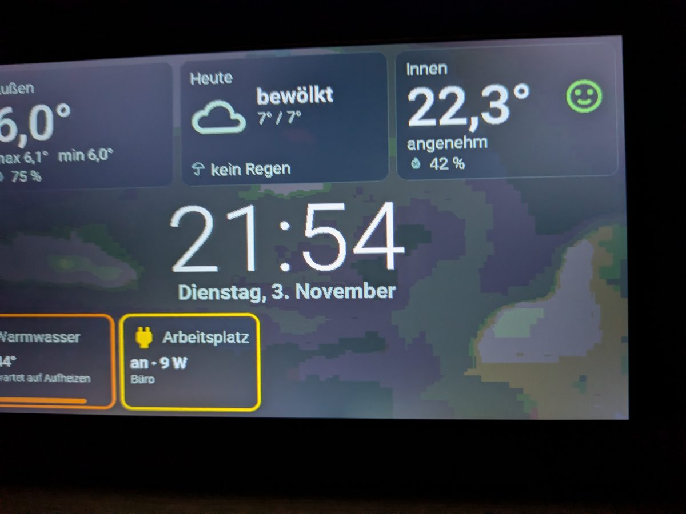
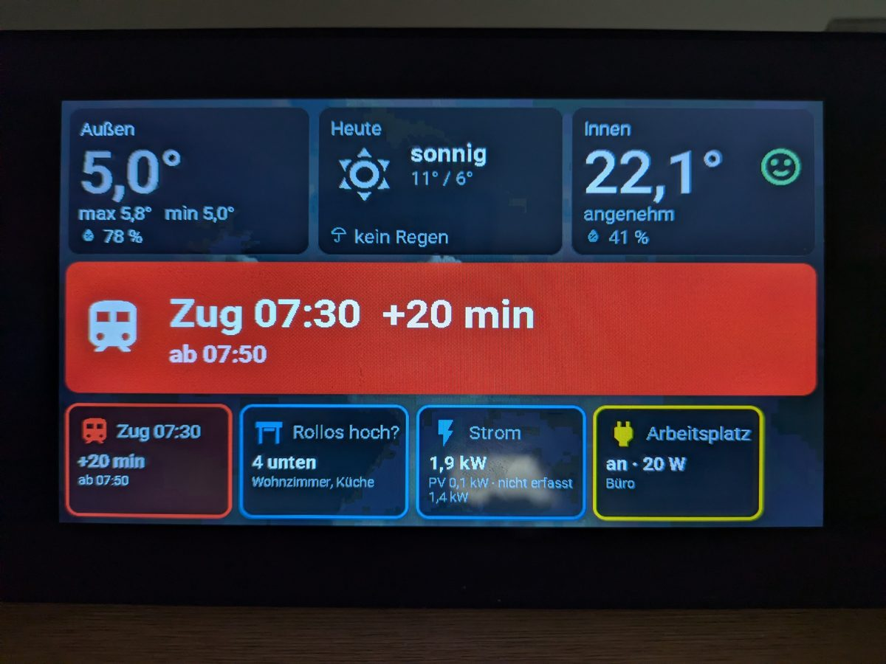
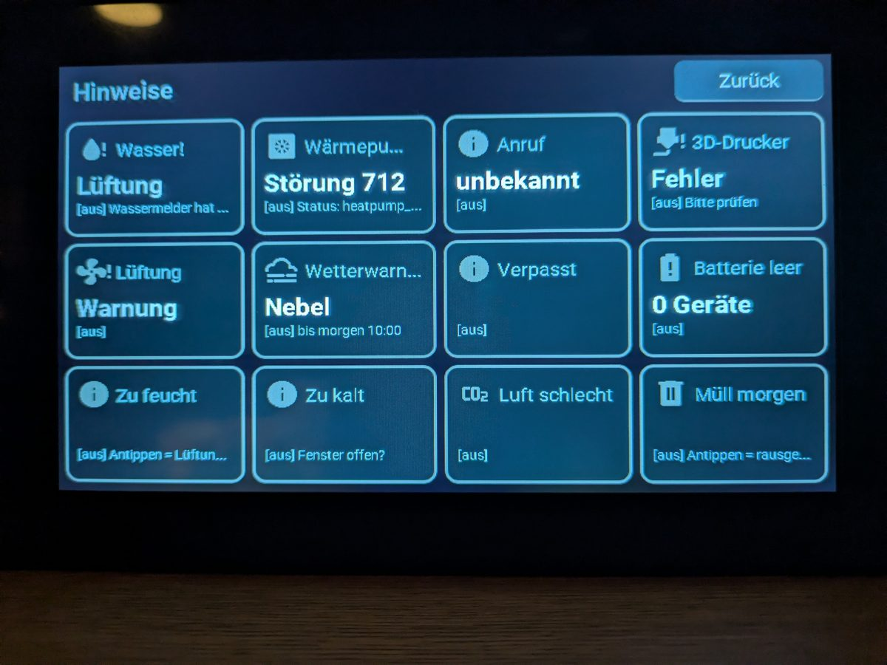
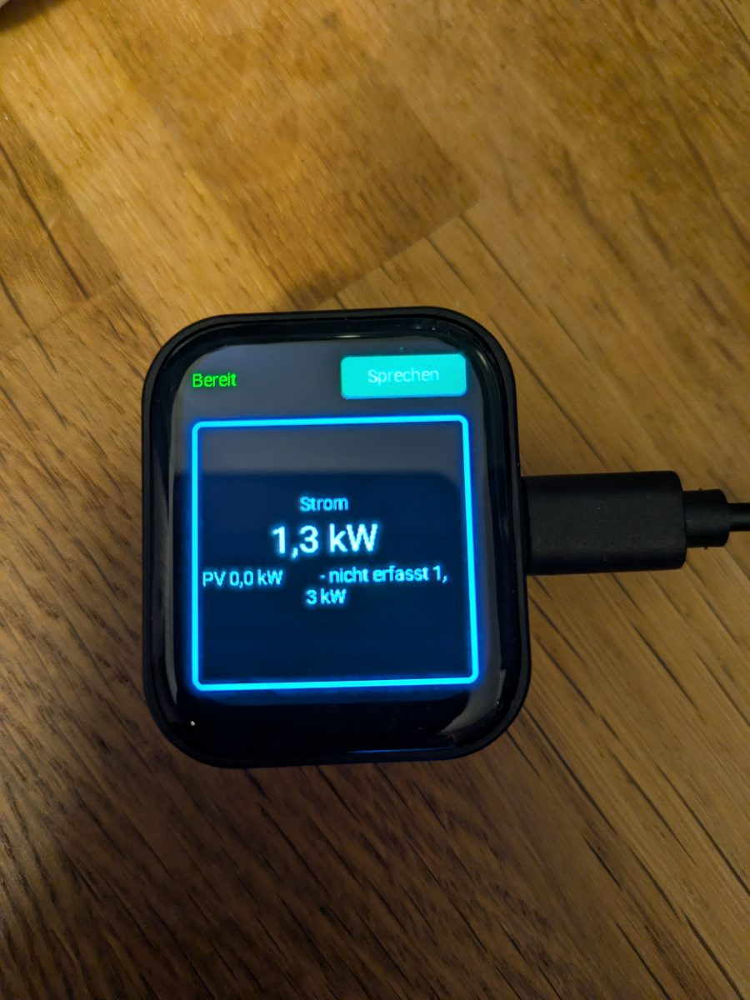
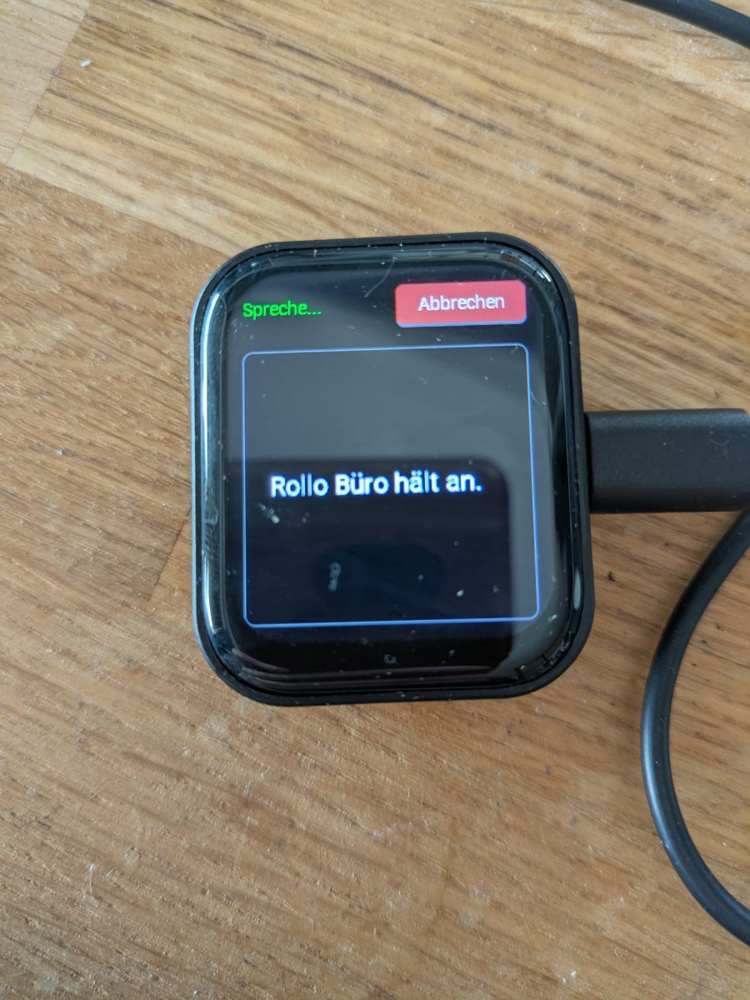

# HA Wall Tiles

Situational **tiles** for ESPHome touch displays and voice satellites, driven entirely by
Home Assistant: a 7" wall display that replaces a weather station, plus small voice satellites
that show answers and let you swipe through the same tiles.

Home Assistant decides *what* is shown; the devices only decide *how*. Adding a tile never
requires reflashing a device.

> Display texts and voice sentences are **German**. Code, comments and docs are English
> (except the comments in the ESPHome files). Translating = editing the strings / blueprint inputs.

## Screenshots

| Wall display: weather station + small tiles | Alarm banner (train +20 min) |
|---|---|
|  |  |

| Full tile view (4×3, debug mode) | Voice satellite C6: tile | Voice satellite C6: answer |
|---|---|---|
|  |  |  |

## Hardware

All devices are Waveshare boards, flashed with ESPHome (running with ESPHome 2026.10).

| Device | Board | ESPHome file | What it does |
|---|---|---|---|
| **Wall display 7"** | Waveshare ESP32-S3-Touch-LCD-7 – ESP32-S3, 16 MB flash, 8 MB PSRAM, 800×480 RGB display, GT911 touch, CH422G IO expander | [`esphome/wall-display.yaml`](esphome/wall-display.yaml) | weather-station base view, up to 4 small tiles + full 4×3 tile view, alarm banner, answer popups, yes/no dialog, tap on tiles. No microphone/speaker. |
| **Voice satellite C6** | Waveshare ESP32-C6-Touch-LCD-1.83 – ESP32-C6, 240×284 ST7789 display, CST816 touch, ES8311/ES7210 audio, QMI8658 IMU, PCF85063 RTC | [`esphome/voice-satellite-c6.yaml`](esphome/voice-satellite-c6.yaml) | Assist voice satellite (push-to-talk button, no wake word), answers on screen, swipe through the tiles, tap = same as on the wall display, yes/no by touch. Optional follow-up commands (a voice automation can make it listen once more, e.g. "Rollo hoch" then "Rollo stop") and an adjustable display timeout plus night mode (screen off, wakes on touch, button, answer or new alarm tile). |
| **Voice satellite S3** | Waveshare ESP32-S3-LCD-0.85 – ESP32-S3, 128×128 ST7735 display, ES8311/ES7210 audio, PLUS/MINUS/PWR buttons, status LEDs | [`esphome/voice-satellite-s3.yaml`](esphome/voice-satellite-s3.yaml) | Assist voice satellite with wake word "Okay Nabu" (micro wake word on the device), answers as icon + short value, yes/no with the PLUS/MINUS buttons. No tiles. |

The files only fit these boards (pins, display drivers). Your own device file in
`esphome/examples/` just sets name, keys and Wi-Fi and pulls the right file from this repository.
Other ESPHome displays can join by implementing the actions/events in [docs/interface.md](docs/interface.md).

## How it is organised

**Logic lives in blueprints, your entities live in one file of your own.**
The repository contains no entity ids of a real home – you pass yours as blueprint inputs
(see [`examples/my_wall_tiles.yaml`](examples/my_wall_tiles.yaml)). Updating = replacing the
blueprint files; your own file stays untouched.

```
blueprints/
  template/wall_tiles/        TILES (one entity per blueprint instance, YAML only)
    tile_socket               smart plug: on/off + power, tap toggles
    tile_binary_alarm         visible while a binary sensor is on (leak, door …)
    tile_device_fault         fault (red) / warning (orange) of a device + error texts
    tile_appliance            running appliance: time left + progress bar
    tile_appliance_done       "Wäsche fertig" – tap = unloaded
    tile_battery_charger      cell charger on a plug: "lädt · noch 3" / "voll"
    tile_3d_printer           Moonraker: progress or error mode
    tile_batteries            all battery sensors below a limit
    tile_room_humidity        all humidity sensors by area, hysteresis, tap = ventilation boost
    tile_room_cold            all temperature sensors by area
    tile_air_quality          all CO₂ / PM2.5 sensors
    tile_weather_warning      DWD warnings, icon by type
    tile_shutters_check       "Rollos runter?" / "Rollos hoch?" – tap runs the group script
    tile_pool                 pH / redox in season
    tile_pv_surplus           PV surplus with hysteresis
    tile_power                house consumption, biggest consumer, "nicht erfasst"
    tile_hot_water            DHW cold, time to heat up, blocking times
    tile_maintenance          collective hints: filter, toner, backup, repairs, offline …
    train_next + tile_train   Deutsche Bahn delay (helper sensor + tile)
    rain_soon + tile_rain     rain within 2 h (hourly forecast; helper sensor + tile)
    weather_forecast_today    today's forecast for the 7" base view (sensor.ws_forecast)
    weather_value             one attribute of the weather entity as a sensor (outdoor humidity …)
    alarm_next                next alarm today/tomorrow: regular workday alarm + one-off special alarm
                              → all weather blueprints find the weather entity themselves and fall
                                back to another one if it is unavailable (e.g. Met.no 503)
  automation/wall_tiles/
    tile_tap_handler          tap on a tile → toggle / run action        (once)
    tiles_push                send tiles to one ESPHome display          (per display)
    calendar_push             send the week calendar to the wall display (with wall_calendar)
    display_brightness        night mode by time (dark at night, a tap wakes); brightness only where a number exists
    weather_background        faded photo behind the base view, chosen by the current weather
    appliance_done_detect     sets the "done" flag of an appliance
    voice_ack_tile            "Müll ist draußen" = tap by voice
    voice_switch_tile         "E-Bike laden" / "E-Bike aus"
    voice_shutters_group      "Untere Rollos runter"
    voice_light_brightness    "Licht heller" / "Licht im Büro dunkler" (satellite's area or {area})
    voice_calendar            "Termine" · "Termine morgen" · "Termine diese Woche" (labels "Kalender <name>")
    voice_time_date           "Wie spät ist es?" · "Welcher Tag ist heute?"
    voice_timer               "Timer zehn Minuten" · "Wie lange noch?" · "Timer aus" (needs a timer + text helper)
    voice_ventilation         "Lüftung aus / an / hoch / normal" · "Läuft die Lüftung?"
    voice_appliance · voice_charging_plug · voice_3d_printer · voice_waste
    voice_train · voice_weather · voice_energy
    wake_light                sunrise light alarm, follows alarm_next (workdays + special alarm)
    voice_alarm               "Wecker sechs Uhr dreißig" · "Wecker gestellt?" · "Wecker aus"
  script/wall_tiles/
    display_answer            → script.display_answer (required)
    shutters_group            open / close a group, one shutter only partially
    appliance_unloaded        clear the done flag (+ press "unloaded" button)
packages/                     only what needs fixed helpers or trigger-based templates
  wall_tiles/tiles_collector  (required) collects all sensor.tile_*
  wall_tiles/tile_waste       waste calendar (Waste Collection Schedule)
  wall_tiles/tile_calls       FRITZ!Box call monitor: incoming + missed calls (+ "Wer hat angerufen?")
  wall_tiles/tile_rain        rain within 2 h (two blueprint calls, nothing to adapt)
  wall_tiles/tile_school      WebUntis cancelled lessons
  voice/voice_shutters        shutters per room by voice, stop, tile "Rollo fährt"
  weather_station             sensor.ws_* for the 7" base view
  weather_background          shell command that picks + prepares the background photo (ffmpeg)
  wall_calendar               optional: week calendar page (one column per label "Kalender <name>") + tile_calendar
examples/my_wall_tiles.yaml   YOUR configuration: all blueprint calls in one package
examples/dashboard_alarm.yaml dashboard card for the alarm clock (next alarm + set times)
esphome/                      device firmware (ESPHome + LVGL) + examples/ for your device files
docs/interface.md             the contract between HA and the devices
tools/check_private.sh        scan for private data before you push
tools/ha_cleanup_check.jinja  paste into Developer tools → Template: missing, doubled, orphaned, unused
```

## Requirements

- Home Assistant 2025.x or newer (template blueprints, `conversation` triggers, labels)
- Packages enabled in `configuration.yaml`:
  ```yaml
  homeassistant:
    packages: !include_dir_named packages
  ```
- ESPHome devices with "Allow the device to perform Home Assistant actions" enabled.
- Voice: Assist with Speech-to-Phrase or any STT. Restart Speech-to-Phrase after adding sentences.

## Installation

1. Copy `blueprints/` into `config/blueprints/` (or import single files by URL).
2. Copy `packages/wall_tiles/tiles_collector.yaml` and the packages you want into `config/packages/`
   and edit their `── ADAPT ──` block.
3. Copy `examples/my_wall_tiles.yaml` to `config/packages/`, delete what you don't have and
   enter your entity ids. (Automations and scripts can also be created in the UI from the blueprints.)
4. *Developer tools → YAML → reload all*.
5. Give every `sensor.tile_*` the label **Display** (Settings → Entities → Labels).
   `input_boolean.wall_tiles_debug` shows all tiles, also hidden/unlabelled ones, for 15 min.

### ESPHome devices

Your device file only contains name and key; the rest is pulled from this repository:

```yaml
substitutions:
  node_name: my-wall-display        # keep your existing name → entity ids stay
  friendly_name: "My Wall Display"
  api_key: !secret wall_display_api_key
packages:
  wall_tiles:
    url: https://github.com/BlinderOpa/HomeassistantTilesDisplays
    ref: main
    files: [esphome/wall-display.yaml]
    refresh: 1d
```

Optional week calendar page on the wall display: add `esphome/wall-display-calendar.yaml` to
`files:` and copy `packages/wall_calendar.yaml` to HA (interface 4.7). Columns are set by labels:
give your `calendar.*` entities labels like `Kalender Anna`, `Kalender Alle` – no YAML to edit.

See `esphome/examples/` and `esphome/secrets.example.yaml`.

## Writing your own tile

```yaml
template:
  - sensor:
      - name: "Tile Garage"          # → sensor.tile_garage, tile id "garage"
        unique_id: tile_garage
        icon: mdi:garage-open
        state: "{{ 'warn' if is_state('cover.garage', 'open') and now().hour >= 21 else 'hidden' }}"
        attributes:
          prio: 24
          title: "Garage offen"
          value: "seit {{ as_local(states.cover.garage.last_changed).strftime('%H:%M') }}"
          tap: "ack"
          action: "script.close_garage"
```

States: `alarm` `warn` `ok` `info` `on` `off` or `hidden`. All fields: [docs/interface.md](docs/interface.md).

## Before you publish your fork

Put your private words (names, town, serials) into `tools/private_terms.txt` (git-ignored) and run
`tools/check_private.sh`. Keep credentials in `esphome/secrets.yaml` (git-ignored).

## License

MIT – see [LICENSE](LICENSE).
